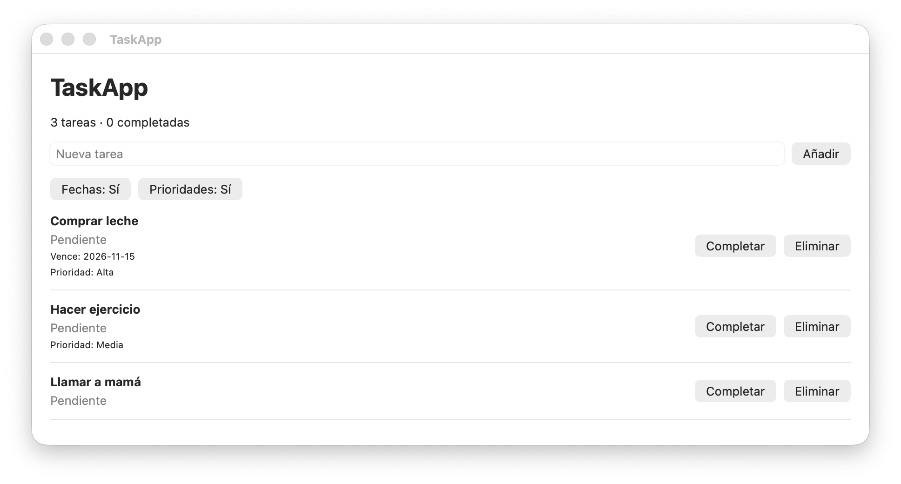
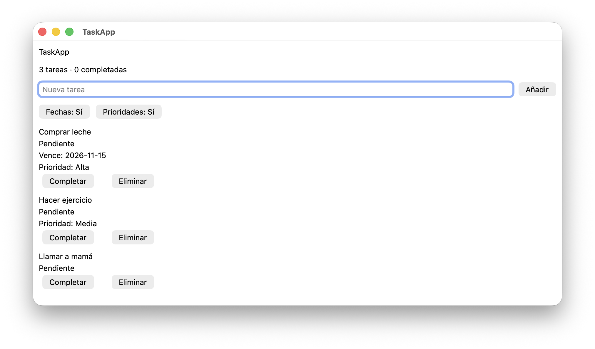
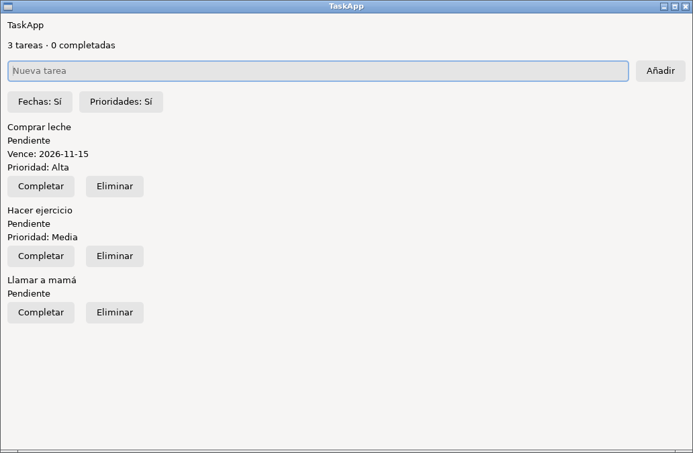

# TaskApp: SwiftUI y SwiftCrossUI

Ejemplo docente independiente para LPS. No sustituye el repositorio histórico uallps/TaskApp ni implementa todavía persistencia o plugins. El mismo código TaskAppCore alimenta las dos interfaces.

## Funcionalidades

El ejemplo permite listar tres tareas de prueba, añadir una tarea, marcarla como completada o reabrirla, eliminarla y activar/desactivar dos características opcionales: fecha de vencimiento y prioridad. El modelo y las reglas no dependen de la interfaz; ambas aplicaciones presentan los mismos textos y acciones.

## Capturas de las tres ejecuciones

Las imágenes corresponden a ventanas reales de la aplicación con las tres tareas iniciales y las dos características activadas. La versión de Linux se capturó con GTK4 y un escritorio X11 virtual (Xvfb y Openbox). Las diferencias tipográficas y de distribución dependen del backend gráfico; no son tres simulaciones de SwiftUI.

**SwiftUI en macOS:**

**SwiftCrossUI en macOS (AppKit):**

**SwiftCrossUI en Linux (GTK4):**

## Estructura

~~~text
taskapp-parity/
├── Core/Package.swift
├── Core/Sources/TaskAppCore/       # Modelo y reglas compartidas
├── Core/Sources/TaskAppParityCLI/  # Escenario JSON reproducible
├── Core/Tests/TaskAppCoreTests/    # Cinco pruebas comunes
├── Apps/Package.swift             # SwiftCrossUI 0.9.0
└── Apps/Sources/
    ├── TaskAppSwiftUI/            # Solo macOS (framework Apple)
    └── TaskAppCrossUI/            # macOS/AppKit y Linux/GTK4
~~~

## Pruebas en macOS

Se requiere Swift 6 y Xcode.

~~~sh
cd examples/taskapp-parity/Core
swift test
swift run TaskAppParityCLI > parity-macos.json

cd ../Apps
swift build --product TaskAppSwiftUI
swift build --product TaskAppCrossUI
swift run TaskAppSwiftUI
# Cierra la ventana; después:
swift run TaskAppCrossUI
~~~

El backend predeterminado de SwiftCrossUI utiliza AppKit en macOS, sin necesidad de instalar GTK.

## Pruebas en Linux

SwiftUI no está disponible de forma nativa en Linux. La implementación Linux es TaskAppCrossUI, que usa GTK4. Se necesita Swift 6 y las librerías de desarrollo de GTK4.

~~~sh
sudo apt-get update
sudo apt-get install -y clang pkg-config libgtk-4-dev

cd examples/taskapp-parity/Core
swift test
swift run TaskAppParityCLI > parity-linux.json

cd ../Apps
swift build --disable-index-store -j 4 --product TaskAppCrossUI
swift run --disable-index-store TaskAppCrossUI
~~~

En Ubuntu 22.04 con Clang 14, la opción de indexado automático puede fallar; por eso desactivamos el indexado durante la compilación. Para comprobar el arranque en un entorno sin escritorio se puede instalar xvfb/xauth y usar xvfb-run. Una prueba de arranque por sí sola no confirma la interacción con los botones.

## Equivalencia funcional

La prueba TaskAppParityCLI ejecuta la misma secuencia en ambos sistemas: alta de una tarea, marcar otra como completada, borrar una y desactivar los dos flags. Produce un JSON determinista y con claves ordenadas; basta comparar su SHA-256:

~~~sh
# macOS
shasum -a 256 Core/parity-macos.json

# Linux
sha256sum Core/parity-linux.json
~~~

Las ventanas deben probarse además con las mismas acciones: tres tareas iniciales, añadir una cuarta, completar, borrar y alternar cada flag.

El resultado funcional debe coincidir, pero no se espera identidad visual píxel a píxel: SwiftUI usa componentes Apple; SwiftCrossUI usa AppKit en Mac y GTK4 en Linux. SwiftCrossUI no replica la API de SwiftUI exactamente.

Los resultados efectivamente comprobados, los entornos y las limitaciones de las pruebas se recogen en [VALIDACION.md](VALIDACION.md).

## Alcance

- Es una demostración de la parte inicial de TaskApp, apropiada para las sesiones de SwiftUI, List y feature flags.
- El estado está en memoria; no se ha incorporado persistencia JSON/Core Data, arquitectura de plugins ni las pantallas avanzadas del TaskApp histórico.
- Las tareas añadidas en la interfaz reciben identificadores UUID aleatorios; el escenario CLI utiliza UUID fijos para poder contrastar su salida en diferentes sistemas.
